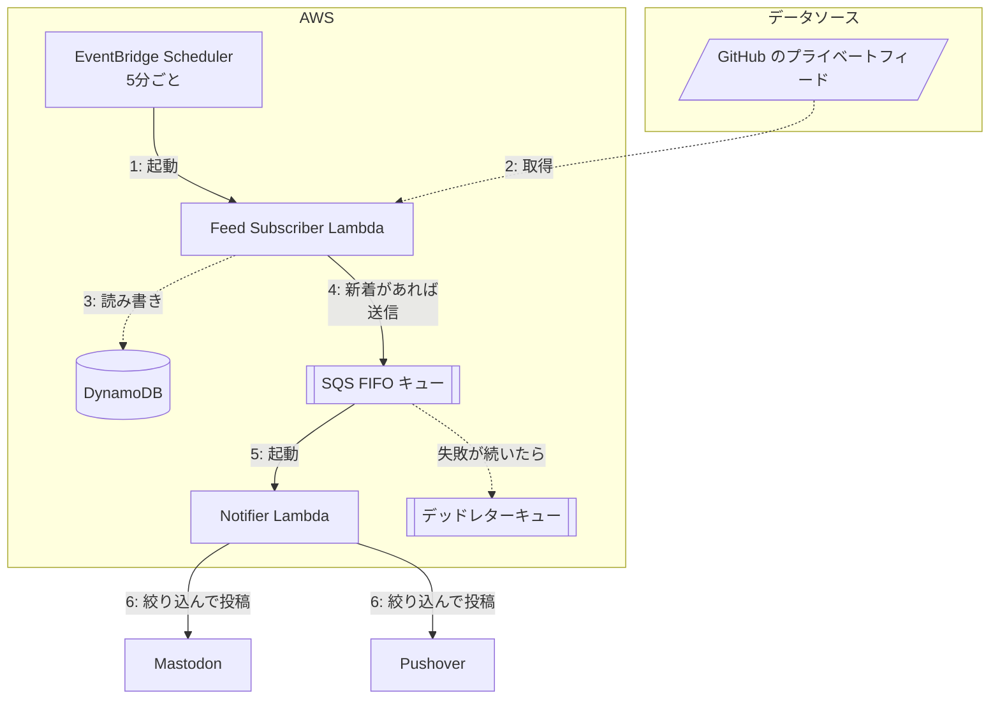
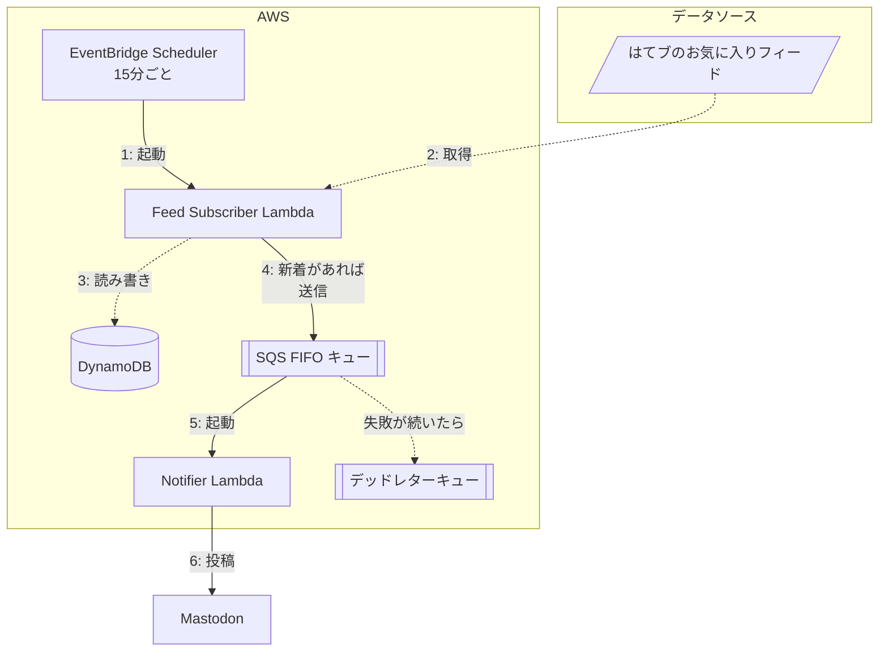

# masutaka-feed

[][Test]
[][Deploy]
[][deepwiki]

[Test]: https://github.com/masutaka/masutaka-feed/actions/workflows/test.yml?query=branch%3Amain
[Deploy]: https://github.com/masutaka/masutaka-feed/actions/workflows/deploy.yml?query=branch%3Amain
[DeepWiki]: https://deepwiki.com/masutaka/masutaka-feed

個人の GitHub のアクティビティと、はてなブックマークのお気に入りを Mastodon に投稿するサーバーレスアプリケーション。

## github/

タイトルが `GH_TITLE_PUSHOVER_REGEXP` に一致するアクティビティは、Pushover にも送る。

## hatebu/

