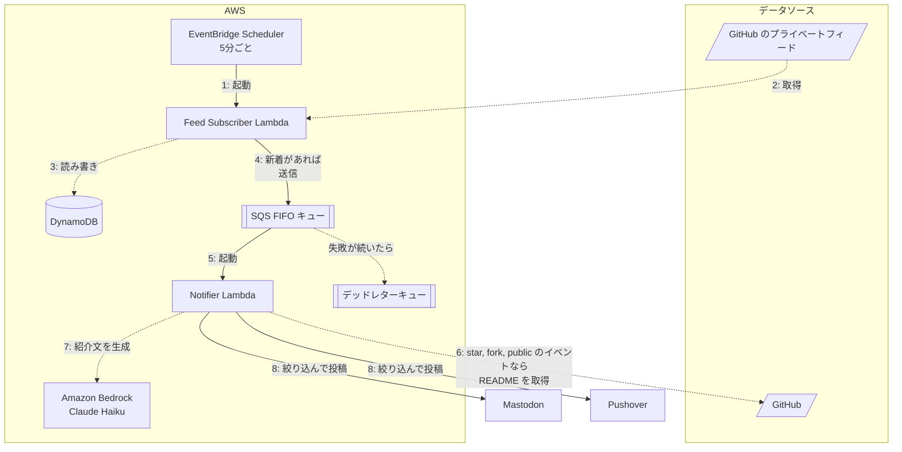
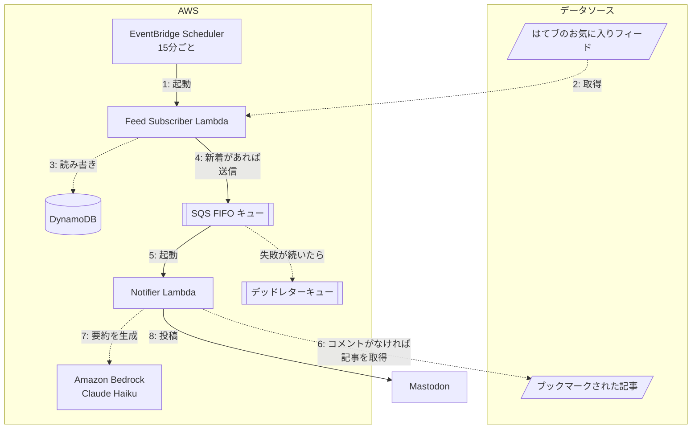

# masutaka-feed

[][Test]
[][Deploy]
[][deepwiki]

[Test]: https://github.com/masutaka/masutaka-feed/actions/workflows/test.yml?query=branch%3Amain
[Deploy]: https://github.com/masutaka/masutaka-feed/actions/workflows/deploy.yml?query=branch%3Amain
[DeepWiki]: https://deepwiki.com/masutaka/masutaka-feed

個人の GitHub のアクティビティと、はてなブックマークのお気に入りを Mastodon に投稿するサーバーレスアプリケーション。

## github/

> [!NOTE]
> 「8: 絞り込んで投稿」の条件は次のとおり。
>
> - Mastodon: `GH_TITLE_IGNORE_REGEXP` か `GH_URL_IGNORE_REGEXP` に一致するものを除いて投稿する
> - Pushover: Mastodon に投稿したもののうち、タイトルが `GH_TITLE_PUSHOVER_REGEXP` に一致するものだけを送る
>
> これとは別に、PR のマージとリリースのイベントは投稿しない。
>
> star, fork, public のイベントの投稿には、README から生成した日本語の紹介文を添える。README の取得や紹介文の生成に失敗したら、紹介なしで投稿する。Pushover に送る内容は変えない。

## hatebu/

> [!NOTE]
> コメントのないブックマークの投稿には、記事から生成した日本語の要約を添える。記事の取得や要約の生成に失敗したら、要約なしで投稿する。

## デプロイ

main にマージすると、GitHub Actions が `make deploy` で `app` スタックをデプロイする。

GitHub Actions のデプロイ用 IAM role と OIDC provider は、`bootstrap.yaml` の `bootstrap` スタックで管理する。GitHub Actions のデプロイでは更新しないため、変更したらローカルから管理者権限で `make deploy-bootstrap` を実行する。
